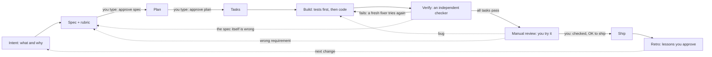
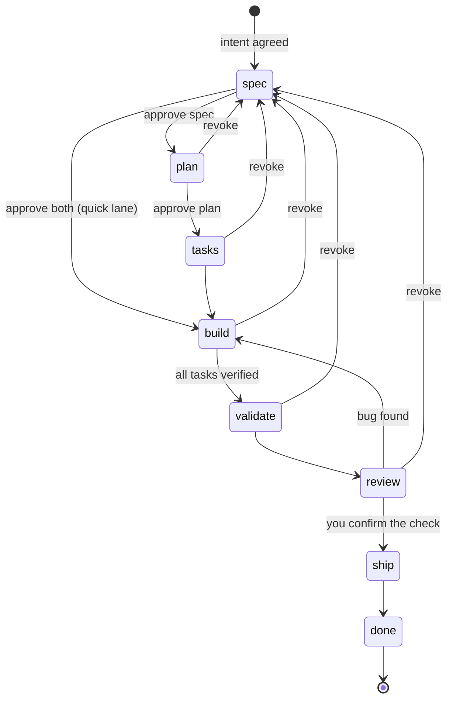

# hold-my-dev-specs

A Claude Code plugin for **spec-driven development**. You explain what you want; the AI writes a
**spec** (a short description of what to build and how to check it) and a **plan** for you to approve.
Only then do helper agents build it in small steps, each one tested and checked by an agent that
didn't build it.

**Status:** version 0.1.0, the first public release. Tested on Linux.

**Contents:** [The method](#the-method) · [The stages and your phrases](#the-stages-and-your-phrases) ·
[Who controls what](#who-controls-what) · [Best practices it follows](#best-practices-it-follows) ·
[How it compares](#how-it-compares) · [Install](#install) · [Quick start](#quick-start) ·
[Profiles](#profiles) · [Requirements](#requirements) · [Permission prompts to expect](#permission-prompts-to-expect) ·
[Limits](#what-the-protections-can-and-cant-do) · [Go deeper](#go-deeper)

## The method
Every change, from "add a logout button" to a new feature, takes the same path. The **master** (your
main Claude session) runs it and starts **helpers** (separate Claude agents, each with one job and a
clean memory) for the building and the checking.



- **Intent:** the agent asks about the goal, who it's for, what's out of scope, and the constraints,
  then repeats it back to you before writing anything.
- **Spec + rubric:** what to build, as numbered checks written as *Given / When / Then* ("Given a
  logged-in user, When they click Log out, Then they see the login page"). The **rubric** is the
  scoring sheet the checker uses later.
- **Plan and tasks:** how to build it, split into tasks small enough to check one by one.
- **Build and verify:** for each task, a test author writes tests that fail first, an implementer makes
  them pass, and a verifier checks the result against the spec with real evidence. A failed task goes to
  a *fresh* implementer with the verifier's findings; after 3 failed rounds (the suggested limit) the
  agent stops and asks you.
- **Manual review, ship, retro:** you try the result; the agent merges (and deploys, if you set that up);
  a retro proposes lessons, and only the ones you approve are written down.

**Quick lane:** a tiny change (a typo, a one-line fix) gets one short spec and one approval,
`approve both`. Same checks, less paperwork; the agent proposes it and you confirm.

## The stages and your phrases
Each feature has a **ledger** (`specs/<feature>/ledger.md`): its progress record. The agent moves it
from stage to stage; **only your typed phrases** record approvals, through a hook (a small script Claude
Code runs before or after actions).



| You type (the whole message, nothing else) | When | What happens |
|---|---|---|
| `approve spec` | the spec and rubric are right | recorded with the time; the agent writes the plan |
| `approve plan` | the plan is right (after the spec) | recorded; building may start |
| `approve both` | quick lane only | spec and plan approved together |
| `revoke` | any time before shipping | both approvals are taken back and building stops |

Each phrase shows a confirmation line (`✅ Spec approved 19:20`, `↩ Approvals revoked …`). A phrase with
anything added records nothing; a near miss such as `approve spec.` shows the exact phrase to type.
`done` is final: new work on a finished feature is a new feature.

## Who controls what
| Stays with you | Automatic |
|---|---|
| The goal, scope and constraints (the agent asks, never guesses) | Writing the spec, rubric, plan and tasks as drafts for you |
| Approving the spec and the plan, by typed phrase | Recording your approval with a timestamp |
| Taking approvals back (`revoke`) | Blocking code changes until both approvals are in |
| Every choice in the project settings (models, paths, commands, how you ship) | Writing tests, writing code, checking each task, retrying failed tasks |
| The manual review before shipping | Merging and the deploy command you configured, after your OK |
| Which retro lessons get written down | Keeping the ledger, committing each verified task |
| Anything that leaves your machine (push, pull request, deploy): permission prompts | Stopping to ask you after the fix-round limit, or when the spec itself looks wrong |

## Best practices it follows
| Practice | How the plugin does it |
|---|---|
| Requirements before code | Spec with Given / When / Then checks; source code is blocked until you approve spec and plan |
| Tests first | A test author writes tests that must fail for the right reason before any code exists |
| Independent review | A verifier that didn't build the task scores it against the rubric with evidence; it can run on a different model |
| Least privilege (each part gets only the rights it needs) | Each helper may write only its own area: the test author only tests, the implementer only source code, checkers only their reports; nobody but the master touches settings, `.claude/`, `CLAUDE.md` or `.git/` |
| Tamper resistance | Builders can't change tests or quality configs; the test author fingerprints its tests and the verifier checks them |
| Small, verified commits | One branch per feature, one commit per verified task, Conventional Commits, never a direct commit on the main branch |
| Decision records | The project's lasting decisions live in [docs/adr/](docs/adr/README.md) |
| Secret safety | An optional safety copy blocks reading or committing secrets and asks before risky commands; Claude Code's own deny rules are recommended too |
| Continuous learning | A retro turns evidence into lessons, written only after your yes |
| Explicit configuration | Every project choice is asked at setup and kept in one settings file; nothing is filled in silently |

## How it compares
Several tools bring specs to AI coding. Each claim below comes from that project's own docs, **checked
on 2026-11-24**; follow the links for the current state.

| | What it is | Approvals before code | Tests first | Independent review | Where it is stronger |
|---|---|---|---|---|---|
| **hold-my-dev-specs** (this) | Claude Code plugin | **Enforced by hooks**: code edits blocked until your typed approvals; approved documents locked | Required (a separate test author) | A separate verifier per task, plus a whole-feature check | — |
| [Spec Kit](https://github.com/github/spec-kit) (GitHub) | Toolkit for 40+ coding agents: constitution → specify → plan → tasks → implement → converge | Review each result before continuing (guidance); hooks and quality gates come as extensions | Not required | Not described as a separate agent | Works with many agents and switches between them, extensions and presets, offline use, not limited to software |
| [Kiro](https://kiro.dev/docs/specs/) (AWS) | Its own agent (IDE, CLI, web): requirements → design → tasks | A review step per phase; its hooks *can* block tools if you write them | Not described | Requirements analysis before design | A complete product (IDE, CLI, web, mobile), EARS requirements, parallel task waves, cloud sessions |
| [Superpowers](https://github.com/obra/superpowers) | Skills plugin for Claude Code and 15 other tools: brainstorm → plan → subagents per task | Sign-off on design and plan (skills; no blocking hook) | Required by its skills | Two-stage review after each task | Broad skill set, git worktrees, a large community (about 326k GitHub stars on 2026-11-24) |
| [BMAD Method](https://github.com/bmad-code-org/BMAD-METHOD) | Agile method with role agents (analyst, PM, architect, developer…) | You decide at review points (guidance) | Optional (acceptance-test mode) | `code-review` with several independent reviewers | Deep planning and product roles, modules beyond software |
| [OpenSpec](https://github.com/Fission-AI/OpenSpec) | Lightweight CLI for 30+ tools: propose → apply → verify → archive change folders | "Review the plan before any code is written" (guidance; no rigid gates by design) | Not described | `verify-change` checks code against the spec | Light, tool-agnostic, spec changes tracked over time, built for existing code |

**In short:** this plugin trades breadth for enforcement. It runs only in Claude Code, is new and has
been tested on Linux only, and its full ceremony costs more usage than a lighter tool (a measured small
feature: about $3 at list prices). In return, the approvals, the test protection and the review are
checked by hooks rather than left to the agent's good behaviour.

## Install
In Claude Code (this repository is its own plugin marketplace, named `connectwithnoor`):
```
/plugin marketplace add ConnectWithNoor/hold-my-dev-specs
/plugin install hold-my-dev-specs@connectwithnoor
```
From a local copy instead: `/plugin marketplace add /path/to/hold-my-dev-specs`, then the same install
line. The plugin does nothing in a project until you set it up there.

## Quick start
1. In a software project, say "set up this project for hold-my-dev-specs". Setup asks a few groups of
   questions (models, how strict, which paths, test commands, how you ship) and writes
   `.claude/hold-my-dev-specs.json`.
2. Ask for a change, e.g. "add a command-line tool that prints a greeting". The agent asks about your
   goal, then writes a spec and a rubric in `specs/001-…/`.
3. Read them and type the phrase it shows. Then the plan, the same way. After that, helpers write the
   tests, the code and the checks; the agent asks you only when something needs your decision.
4. Check the result when asked ("checked, OK to ship"). Afterwards, "what can we learn from this
   feature?" starts a short retro.

## Profiles
How strict the plugin is, chosen at setup (details: [guides/project-config.md](guides/project-config.md)):

| Profile | What it adds |
|---|---|
| `minimal` | approvals, plan gate, builders kept away from tests and protected files |
| `standard` (suggested) | + safety rules, helper briefs with the files they need, a status note on each message |
| `strict` | + format / lint / typecheck **run automatically** after each reply while building (the commands from your settings, outside the permission prompts); protected files locked for the main agent too |

## Requirements
- **Claude Code 2.1.295 or newer.** Older versions can't make a crashing safety check block the
  action, so the plugin's protections wouldn't be reliable.
- **Node.js 22 or newer.** Node.js runs the plugin's small check scripts (hooks). Check it the way the
  hooks see it: `sh -c 'node --version'` (Node loaded only in interactive shells, e.g. by a version
  manager, doesn't count). Without Node, projects that use the plugin block every edit, shell command
  and helper start, on purpose: the checks can't run. Other projects are not affected. To recover,
  install Node, or turn the plugin off with `/plugin`.
- Tested on **Linux only** so far.

## Permission prompts to expect
- **Setup writes into `.claude/`.** Claude Code always asks before changing files there, so setup's
  settings file (and allow rules, if you choose them) each show one prompt.
- **Project commands such as `npm test`** ask every time in `acceptEdits` mode. Setup offers allow
  rules so they run without asking, either shared with the team or just for you. It also warns when a
  builder could change what an allowed command runs (for example `package.json` isn't protected).
- **Merging into the main branch** may ask once if your own safety rules guard it. That is expected,
  not an error. Commits may also ask, unless you allow `git commit`.

## What the protections can and can't do
The plugin's checks stop careless mistakes, such as a helper editing tests or code changing before you
approved the plan. They are **best-effort, not airtight**:
- A script run inside a shell command can still change files without the checks seeing it.
- File names that a command gets from somewhere else (for example `xargs cat < list.txt`) can't be
  seen by text checks either, and neither can some rarer in-place edits (`awk -i inplace`,
  `find … -exec sed -i …`).
- Helpers can't run `git stash`, `reset --hard`, `merge`, `cherry-pick`, `revert` or change branches,
  but the main agent can; the safety rules ask before the ones that can lose work.
- An approval is recorded from the message text alone. A prompt that the main agent sends itself (a
  scheduled or repeated prompt) reaches the same check; the ✅ line shows when anything was recorded.
- A Grep over a whole folder can still read secret files; Claude Code's deny rules below are the real
  protection.

A separate review step (the verifier's comparison of all changes) catches what slips through.

**Safety rules.** The plugin also brings a safety copy: it blocks secrets and dangerous commands, and
asks before risky ones. It works only in projects that have `.claude/hold-my-dev-specs.json`, and it
never blocks reading files because of its own error. For secrets, also add Claude Code's built-in deny
rules to your `~/.claude/settings.json`. Claude Code enforces them itself, with no script involved:
```json
{ "permissions": { "deny": ["Read(//**/.env)", "Read(//**/.envrc)", "Read(//**/*.pem)", "Read(//**/*.key)", "Read(~/.ssh/**)", "Read(~/.aws/**)"] } }
```
If you already have your own safety hooks, switch the copy off: add `"HOLD_MY_DEV_SPECS_SAFETY": "off"`
to the `env` section of the same file.

## Go deeper
- [How it works](docs/how-it-works.md): every skill, helper and hook, one task step by step, and how it
  saves context and usage.
- [Decision records](docs/adr/README.md): why it works the way it does.
- The exact rules: [lifecycle](guides/lifecycle.md), [files and write rights](guides/artifacts.md),
  [ledger](guides/ledger.md), [project settings](guides/project-config.md).
- Test runs and costs: [sample run](docs/research/sample-run.md), [evals](docs/research/s10-evals.md),
  [audit](docs/research/s12-audit.md).
- [Contributing](CONTRIBUTING.md).

## License
[MIT](LICENSE): free to use, change and share; keep the copyright notice.
